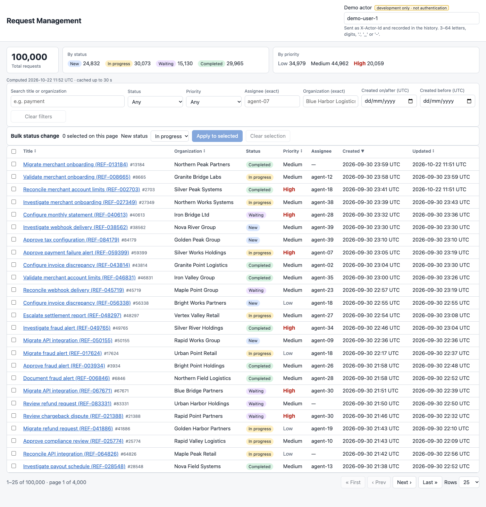
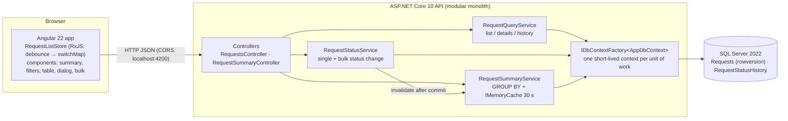

# Request Management — Full-Stack Take-Home

A request-management system: **ASP.NET Core 10 Web API + EF Core 10 + SQL Server 2022 + Angular 22**, over a deterministic
**100,000-request** dataset. It covers server-side filtering/search/sort/paging, status changes with **optimistic concurrency
(SQL Server `rowversion`)** and an **atomic, immutable audit history**, **partial-success bulk updates** (≤100), a **cached summary**
with two SQL aggregations, Swagger UI, and tests against a real SQL Server.



More screenshots (all captured from the running app): [filtered page 2](docs/screenshots/02-filtered-page-2.png) ·
[status saved + history](docs/screenshots/03-status-saved-with-history.png) · [409 conflict](docs/screenshots/04-conflict-409.png) ·
[bulk partial success](docs/screenshots/05-bulk-partial-success.png) · [Swagger Try it out → 409](docs/screenshots/06-swagger-try-it-out-409.png)

> **Exam requirement vs. our assumptions.** The status transition matrix, URL/payload shapes, the development-only `X-Actor-Id`
> header, page-size caps, case/collation behaviour and the partial-success bulk policy are **implementation decisions**, not
> requirements from the original PDF. They are listed in [docs/DECISIONS.md](docs/DECISIONS.md#what-the-exam-requires-vs-what-we-decided).

## Contents

[Architecture](#architecture) · [Versions](#versions) · [Prerequisites](#prerequisites) · [Quick start](#quick-start) ·
[Configuration](#configuration) · [Swagger](#swagger--openapi) · [API examples](#api-examples) · [Tests](#tests) ·
[Seeding](#seeding-and-resetting-demo-data) · [Concurrency & audit](#concurrency-status-rules-and-audit) · [Cache](#cache) ·
[Performance](#indexes-and-performance) · [Decisions](#key-decisions) · [Limitations](#known-limitations-and-improvements) ·
[Security](#security-and-data-handling) · [AI use](#ai-use) · [Submission](#submission) · [Docs index](#documentation-index)

## Architecture



| Layer | Responsibility |
|---|---|
| Controllers | HTTP contract only: binding, validation results, status codes, ProblemDetails. No business logic. |
| `RequestQueryService` | Builds `IQueryable` filters/sort/paging that run in SQL; projects to DTOs. |
| `RequestStatusService` | Transition rules, client-token concurrency check enforced by the DB, status + audit in one `SaveChanges`; bulk = same path per item. |
| `RequestSummaryService` | Two `GROUP BY` aggregations, cached 30 s with a versioned key. |
| EF Core | The data-access abstraction (no extra repository layer). Fluent configuration in `Data/Configurations/`. |
| Angular | One page; a store owns the query pipeline; an API service owns all URLs; typed DTOs. |

Repository layout: `backend/RequestManagement.Api` (API), `backend/RequestManagement.Tests` (xUnit), `frontend/request-management-ui`
(Angular), `scripts/` (setup and demo as bash + PowerShell, SQL, perf), `docs/`.

## Versions

Exact versions used and verified for this submission (2026-10-22):

| Component | Version |
|---|---|
| .NET SDK / runtime | 10.0.201 / 10.0.5 (`global.json` pins SDK 10.0.201, `rollForward: latestFeature`) |
| EF Core (SqlServer, Design), `dotnet-ef` local tool | 10.0.13 |
| Microsoft.AspNetCore.OpenApi / Swashbuckle.AspNetCore.SwaggerUI | 10.0.13 / 10.3.1 |
| xUnit / xunit.runner.visualstudio / Microsoft.NET.Test.Sdk / Mvc.Testing | 2.9.3 / 3.1.5 / 18.11.0 / 10.0.13 |
| Node.js / npm | 24.15.0 / 11.17.0 |
| Angular / TypeScript / RxJS / Vitest | 22.2.3 / 6.0.3 / 7.8.2 / 5.0.5 (`package-lock.json` committed) |
| SQL Server | 2022 Developer 16.0.4255.1 (CU25), image `mcr.microsoft.com/mssql/server:2022-latest` |
| Docker | 29.x (Rancher Desktop) with Compose v2 |

## Prerequisites

- .NET SDK 10.0.201+ · Node.js 24.15+ (Angular 22 requires `^22.22.3 || ^24.15.0 || >=26`) · Docker with Compose v2 ·
  bash/zsh on macOS/Linux, or PowerShell on Windows (Windows PowerShell 5.1 or PowerShell 7+; see [Windows](#windows-powershell)).
- **SQL Server on ARM hosts:** the official SQL Server image is **AMD64-only**. `docker-compose.yml` pins `platform: linux/amd64`.
  On Apple Silicon this runs under emulation; it was verified here with Rancher Desktop + Rosetta (`docker info` shows
  `lima-vm.io/rosetta`). Docker Desktop needs "Use Rosetta for x86/amd64 emulation" enabled. Without working emulation, use any
  reachable SQL Server 2019+ instead (see [External SQL Server](#external-sql-server)). There is deliberately **no SQLite/InMemory
  fallback**: the concurrency behaviour depends on real `rowversion` semantics.

## Quick start

```bash
# 1. Local secrets (gitignored). Put two strong passwords in .env (see the comments in the file).
cp .env.example .env

# 2. SQL Server + migrations + least-privilege runtime login + 100K seed (idempotent; 11 s here with the image
#    already pulled — the first run also downloads the SQL Server image)
./scripts/dev-db-setup.sh

# 3. API on http://localhost:5080  (Swagger: http://localhost:5080/swagger)
source scripts/dev-env.sh
dotnet run --project backend/RequestManagement.Api --launch-profile http

# 4. UI on http://localhost:4200  (second terminal)
cd frontend/request-management-ui
npm ci        # npm 11 holds back install scripts of esbuild/lmdb/… (warning "allow-scripts"); build and tests work without them
npm start
```

`dev-db-setup.sh` runs: `docker compose up -d --wait`, `dotnet run … -- migrate`, `scripts/sql/create-runtime-user.sql`
(creates `rm_app`), `dotnet run … -- seed`. Expected end of output:
`Rows: Requests=100,000, RequestStatusHistory=133,740`.

### Windows (PowerShell)

Every bash script has a PowerShell counterpart next to it that runs the same steps. No bash, WSL, curl or Python is needed
(Python only for the optional performance script).

```powershell
# 0. Windows client editions block .ps1 files by default. Allow local scripts for THIS window only (not saved anywhere):
Set-ExecutionPolicy -Scope Process -ExecutionPolicy RemoteSigned

# 1. Local secrets (gitignored). Put two strong passwords in .env (see the comments in the file).
Copy-Item .env.example .env

# 2. SQL Server + migrations + least-privilege runtime login + 100K seed (idempotent)
.\scripts\dev-db-setup.ps1

# 3. API on http://localhost:5080  (Swagger: http://localhost:5080/swagger)
.\scripts\dev-env.ps1
dotnet run --project backend/RequestManagement.Api --launch-profile http

# 4. UI on http://localhost:4200  (second window)
cd frontend/request-management-ui
npm ci
npm start
```

| macOS / Linux (bash) | Windows (PowerShell) | What it does |
|---|---|---|
| `./scripts/dev-db-setup.sh` | `.\scripts\dev-db-setup.ps1` | Start SQL Server, migrate, create `rm_app`, seed |
| `source scripts/dev-env.sh` | `.\scripts\dev-env.ps1` | Set the three `ConnectionStrings__*` variables in the current terminal (repeat in every new one) |
| `scripts/demo-api-flow.sh [base-url]` | `.\scripts\demo-api-flow.ps1 [base-url]` | 200 → 409 → 422 → history → bulk → summary against a running API |
| `python3 -I scripts/perf/run_perf.py` | `py -3 -I scripts\perf\run_perf.py` | Performance measurements ([docs/PERFORMANCE.md](docs/PERFORMANCE.md)) |

- `dev-env.ps1` does not need to be dot-sourced: a script can set the environment variables of its PowerShell window. Elsewhere
  in this README, read `source scripts/dev-env.sh` as `.\scripts\dev-env.ps1` and `export NAME='…'` as `$env:NAME = '…'`.
- Docker Desktop must use Linux containers (its default). `dev-db-setup.ps1` stops at the first failing step, like the bash version.
- `demo-api-flow.ps1` accepts plain `http://` only for localhost; for any other host pass an `https://` URL.
- `.gitattributes` keeps `*.sh`, `*.sql`, `*.conf` and `Dockerfile` with LF line endings in Windows checkouts, so the bash scripts
  also run from Git Bash or WSL and the files used inside the Linux containers are the ones that were tested.
- **Not yet verified on Windows:** the PowerShell scripts mirror the bash scripts step for step, but every run recorded in this
  README was done on macOS.

Or use the Docker Compose stack below, which needs no local .NET or Node at all (the same commands work in PowerShell).

### Run everything with Docker Compose (no local .NET / Node needed)

```bash
cp .env.example .env                           # set the two passwords
docker compose --profile app up -d --build     # SQL Server + seed + runtime login + API + UI
```

Then open **http://localhost:4200** (UI) and **http://localhost:5080/swagger** (Swagger UI).

| Service | What it does | Lifetime |
|---|---|---|
| `sqlserver` | SQL Server 2022 (AMD64 image; emulated on Apple Silicon), data in volume `rm-sqlserver-data` | long-running |
| `db-seed` | API image running `seed`: migrations + 100K demo data, as `sa` (no-op if already seeded) | exits 0 |
| `db-runtime-user` | runs `scripts/sql/create-runtime-user.sql` (least-privilege `rm_app` login), copied into a small image at build time | exits 0 |
| `api` | API on `127.0.0.1:5080`, connects as `rm_app`, non-root container | long-running |
| `ui` | production Angular build on unprivileged nginx, `127.0.0.1:4200`, security headers + CSP | long-running |

Useful commands:

```bash
docker compose --profile app ps                 # status (db-seed / db-runtime-user show "Exited (0)" when done)
docker compose --profile app logs -f api        # API log incl. the SQL EF generates
docker compose --profile app run --rm db-seed reset-and-seed   # regenerate the demo dataset
docker compose --profile app down               # stop everything, keep the data volume
docker compose --profile app down -v            # stop and DELETE the database volume
```

The stack bind-mounts **no host folder** (everything reaches the containers through build contexts and a named volume), so it
does not depend on Docker Desktop file sharing or Windows path translation. After editing `scripts/sql/create-runtime-user.sql`,
keep `--build` so the `db-runtime-user` image picks up the change.

Plain `docker compose up -d --wait` (no profile) still starts **only SQL Server**, for running the API/UI from source as in the
steps above. Don't run both at once: the source-run API/UI and the containers use the same ports (5080, 4200).
The stack is a **local demo**: the containers run with `ASPNETCORE_ENVIRONMENT=Development` (Swagger, demo `X-Actor-Id`) and trust
the SQL container's self-signed certificate.

Verified on 2026-10-22 (Apple Silicon, Rancher Desktop): images built (API 347 MB, UI 54 MB), both one-shot steps exited 0, the API
and UI containers run as non-root (`app`, `nginx`), the UI's CSP causes no browser errors, and the same Chrome walkthroughs as above
(UI incl. 409 and bulk; Swagger GET → PATCH 200 → PATCH 409) passed against the containers. `run --rm db-seed reset-and-seed` regenerated the data in 7.6 s.

### External SQL Server

Point the connection strings at your server (TLS on: `Encrypt=True`; use `TrustServerCertificate=False` with a CA-signed
certificate), then:

```bash
export ConnectionStrings__RequestManagementAdmin='Server=myhost;Database=RequestManagementDemo;User ID=<admin>;Password=<from your secret store>;Encrypt=True'
dotnet run --project backend/RequestManagement.Api --launch-profile http -- seed          # migrates, then seeds
RM_APP_PASSWORD='<new password>' sqlcmd -S myhost -U <admin> -i scripts/sql/create-runtime-user.sql   # edit the DB name in the script if not RequestManagementDemo
export ConnectionStrings__RequestManagement='Server=myhost;Database=RequestManagementDemo;User ID=rm_app;Password=<…>;Encrypt=True'
```

PowerShell: use `$env:ConnectionStrings__RequestManagementAdmin = '…'` instead of `export`, and for `sqlcmd` set
`$env:RM_APP_PASSWORD = '…'` first and `Remove-Item Env:RM_APP_PASSWORD` afterwards.

## Configuration

No secret is stored in the repository. Connection strings come from environment variables (or `dotnet user-secrets`, enabled in
Development); in a real deployment they come from a managed secret store (e.g. Azure Key Vault / Kubernetes secrets).

| Setting | Purpose | Example / default |
|---|---|---|
| `ConnectionStrings__RequestManagement` | API runtime, **least-privilege** `rm_app` | `Server=127.0.0.1,14333;Database=RequestManagementDemo;User ID=rm_app;Password=…;Encrypt=True;TrustServerCertificate=True` |
| `ConnectionStrings__RequestManagementAdmin` | `migrate` / `seed` / `reset-and-seed` (DDL + bulk insert); falls back to the runtime string | `…;User ID=sa;…` |
| `ConnectionStrings__RequestManagementTests` | Integration tests; database name **must end in `_Tests`** (dropped and recreated per run) | `…;Database=RequestManagement_Tests;User ID=sa;…` |
| `.env`: `MSSQL_SA_PASSWORD`, `RM_APP_PASSWORD`, `SQLSERVER_PORT` | Local container only; read by Compose and `scripts/dev-env.sh` | port `14333`, bound to `127.0.0.1` |
| `DemoIdentity:Enabled` | Accept `X-Actor-Id` (dev only). `false` ⇒ mutations return `403` | `true` in `appsettings.Development.json`, `false` in `appsettings.json` |
| `Cors:AllowedOrigins` | Explicit browser origins | `["http://localhost:4200"]` in Development, `[]` otherwise |
| `ASPNETCORE_ENVIRONMENT` | `Development` enables Swagger/OpenAPI, demo identity, EF SQL logging, `reset-and-seed` | set by `launchSettings.json` |

Ports: API `5080` (HTTP, `https` profile adds `5081`), Angular `4200`, SQL Server `14333 → 1433`. The UI's API origin is the
`API_BASE_URL` token in `src/app/core/api-base-url.ts`. `TrustServerCertificate=True` is only for the local container's
self-signed certificate. Outside Development the API enforces HTTPS redirection + HSTS.

## Swagger / OpenAPI

- **Swagger UI:** http://localhost:5080/swagger · **OpenAPI JSON:** http://localhost:5080/openapi/v1.json (Development only; not exposed elsewhere).
- Every operation documents its parameters (allowed enum values, sort allow-list, defaults, inclusive/exclusive dates), body
  schemas and every response (`200/400/403/404/409/422/500`, errors as `application/problem+json`).
- **Try it out** is enabled by default. To change a status:
  1. `GET /api/requests/{id}` → copy `rowVersion` from the response (a real token, e.g. `AAAAAAADzBY=`).
  2. `PATCH /api/requests/{id}/status` → `X-Actor-Id: demo-user-1`, body `{ "status": "InProgress", "expectedVersion": "<that token>" }` → `200` with a **new** `rowVersion`.
  3. Execute the same PATCH again → `409 ConcurrencyConflict` (the token is now stale). Verified in Chrome:
     [screenshot](docs/screenshots/06-swagger-try-it-out-409.png).
- `X-Actor-Id` is a **development-only demo identity, not authentication** (see [Security](#security-and-data-handling)).

## API examples

| Call | Purpose |
|---|---|
| `GET /api/requests?status=New&priority=High&q=payment&page=1&pageSize=25&sortBy=createdAt&sortDirection=desc` | filtered, searched, sorted page + `totalCount` |
| `GET /api/requests/{id}` | one request incl. `rowVersion` and `allowedNextStatuses` |
| `PATCH /api/requests/{id}/status` + `X-Actor-Id` | `{ "status", "expectedVersion" }` → 200 / 400 / 404 / 409 / 422 |
| `GET /api/requests/{id}/history` | audit entries, newest first (`[]` if none, 404 if no request) |
| `PATCH /api/requests/bulk-status` + `X-Actor-Id` | `{ "items": [ { "id", "status", "expectedVersion" } … ≤100 ] }` → 200 with per-item outcomes |
| `GET /api/requests/summary` | `totalCount`, `byStatus`, `byPriority`, `generatedAt` |
| `GET /health` | process health |

Full request/response pairs with **real runtime tokens**, including a deliberately provoked `409`: [docs/API_EXAMPLES.md](docs/API_EXAMPLES.md).
Reproduce them: `scripts/demo-api-flow.sh`, or `.\scripts\demo-api-flow.ps1` on Windows (makes real changes; `reset-and-seed`
restores the dataset).

## Tests

```bash
source scripts/dev-env.sh                          # provides ConnectionStrings__RequestManagementTests (Windows: .\scripts\dev-env.ps1)
dotnet test                                        # all backend tests (needs SQL Server)
dotnet test --filter "Category!=Integration"       # unit + smoke only (no database)

cd frontend/request-management-ui
npm test -- --watch=false                          # Angular (Vitest)
```

Results of the last run (2026-10-22, this machine):

| Suite | Result | Notes |
|---|---|---|
| Backend unit (`Tests/Unit`) | **23 passed** | transitions, token parsing, seeder determinism and shape |
| Backend smoke (`OpenApiSmokeTests`) | **3 passed** | OpenAPI document, Swagger UI, 403 when demo identity disabled — no DB needed |
| Backend integration (`Tests/Integration`, real SQL Server 2022) | **41 passed** | filtering/paging/sorting, validation, concurrency (sequential, injected race, 8 parallel), audit atomicity, history, bulk mixed outcomes, cache invalidation |
| **Backend total** | **67 passed, 0 failed, 0 skipped** | |
| Angular (`*.spec.ts`) | **8 passed** | debounce + distinct, cancellation of in-flight request, page reset, UTC bounds, error state, 409 conflict UX, 422 message |

Without SQL Server the integration tests **fail** with a `BLOCKED: … ConnectionStrings__RequestManagementTests` message (they are
not skipped or faked); the unit/smoke filter above still runs. The test fixture refuses any database whose name does not end in
`_Tests`. Mutation checks (tests fail when the concurrency code is broken on purpose) are listed in [docs/AI_USAGE.md](docs/AI_USAGE.md#mutation-checks-do-the-tests-catch-the-bugs-they-claim-to).

## Seeding and resetting demo data

```bash
source scripts/dev-env.sh                                                                    # Windows: .\scripts\dev-env.ps1
dotnet run --project backend/RequestManagement.Api --launch-profile http -- migrate          # apply migrations only
dotnet run --project backend/RequestManagement.Api --launch-profile http -- seed             # migrate + seed if absent (idempotent)
dotnet run --project backend/RequestManagement.Api --launch-profile http -- reset-and-seed   # Development + demo DB only: delete & regenerate
```

- Deterministic: random seed `20261001`, time anchor `2026-10-01T00:00:00Z`, IDs 1..100,000; 200 organizations, 40 assignees
  (~15 % unassigned), searchable title terms (`payment`, `refund`, `invoice`, `chargeback`, … plus `REF-000123`), legal status histories.
- `seed` never duplicates: a `DemoSeedInfo` row marks the database; seeding into a non-empty, unmarked database is refused.
- `reset-and-seed` runs only with `ASPNETCORE_ENVIRONMENT=Development` and only against a marked (or empty) database, in one transaction.
- The API never migrates, seeds or deletes data on startup. Optional `--count N` for a smaller dataset.

## Concurrency, status rules and audit

- **Rules (assumption):** `New → InProgress | Waiting`; `InProgress → Waiting | Completed`; `Waiting → InProgress | Completed`;
  `Completed` is terminal. Forbidden → `422 InvalidStatusTransition` (with `currentStatus`, `allowedNextStatuses`).
- **Optimistic concurrency:** every DTO has `rowVersion` (base64 of SQL Server's 8-byte `rowversion`). Clients send the token they
  read as `expectedVersion`. The service puts **the client's token** in EF's original value, so SQL Server executes
  `UPDATE … WHERE Id = @id AND RowVersion = @clientToken`; zero rows ⇒ `409 ConcurrencyConflict`. A pre-check gives an early 409
  (also for a stale "same status" no-op) but the database condition is the guarantee. No locks, no silent retries, no overwrites.
- **No-op:** same status + current token ⇒ `200`, nothing written (no new `rowVersion`, `updatedAt` or history).
- **Audit atomicity:** the status `UPDATE` and the history `INSERT` go through one `SaveChanges` (one transaction); they commit
  together or not at all. `UpdatedAt` and `ChangedAt` are the same sampled UTC instant. The runtime DB login can `INSERT` history
  but not `UPDATE`/`DELETE` it, and no endpoint writes history directly.
- **UI:** on `409` the dialog says another user changed the request, does not retry, and offers **Refresh**, which reloads the
  request, its token and allowed transitions.

## Cache

Only `GET /api/requests/summary` is cached (`IMemoryCache`, **30 s absolute**). It is invalidated **after** every committed status
change (single or each bulk item); rejected changes do not invalidate. Invalidation bumps a generation number that is part of the
key, so a summary query that was in flight during a commit cannot repopulate the active key with stale counts.
**Limitation:** the cache is per process. With several API instances, other instances may serve counts up to 30 s old; changes
made outside the API (SQL, `reset-and-seed`) are also seen only after expiry. A multi-instance deployment needs a distributed
cache plus cross-instance invalidation (e.g. Redis + pub/sub); intentionally not built here. Details: ADR-003.

## Indexes and performance

Indexes (all chosen from query patterns, each ending in `CreatedAt DESC, Id DESC` to give sort-free ordered seeks):
`(CreatedAt, Id)`, `(Status, …)`, `(Priority, …)`, `(AssignedTo, …)`, `(OrganizationName, …)`, history `(RequestId, ChangedAt DESC, Id DESC)`.
Highlights of the measured results on 100K rows ([docs/PERFORMANCE.md](docs/PERFORMANCE.md)):

- Filtered first page via index seek: 79–80 logical reads; `assignedTo` count 30 reads (2,525 without its index).
- `q` substring search: full clustered scan (2,525 reads), the main bottleneck. B-tree indexes cannot help `LIKE '%term%'`.
- Deep `OFFSET` (page 2000): 153,511 reads; a measured deferred-join rewrite needs 461.
- Summary: two narrow-index scans (~775 reads each); cached call ≈ 0.8 ms over HTTP.

## Key decisions

1. **SQL Server `rowversion` + EF optimistic concurrency** instead of pessimistic locks or app-managed version numbers — no locks
   across user think time, database-enforced, works across instances ([ADR-001](docs/DECISIONS.md#adr-001--optimistic-concurrency-with-sql-server-rowversion--ef-core)).
2. **Partial-success bulk with one transaction per item** instead of all-or-nothing — valid changes survive, precise per-item
   outcomes ([ADR-002](docs/DECISIONS.md#adr-002--bulk-status-update-partial-success-with-one-transaction-per-item)).
3. Also: summary-only in-process cache (ADR-003), SqlBulkCopy deterministic seeder (ADR-004), dev-only actor header (ADR-005).

## Known limitations and improvements

- **Limitation:** `q` search scans the table (≈210 ms SQL under emulation for 100K rows) and deep OFFSET pages get slower linearly.
  **Improvement:** SQL Server Full-Text Search for `q`; keyset (cursor) pagination or the measured deferred join for deep pages.
- **Limitation:** no authentication; `X-Actor-Id` is trusted in Development. **Improvement:** JWT/OIDC and `ChangedBy` from claims.
- **Limitation:** process-local summary cache (see above). **Improvement:** distributed cache + invalidation messages.
- **Limitation:** bulk selection is limited to the rows on the current page (max 100); it is cleared when the query changes.
- History is returned unpaged (fine for realistic histories; the transition matrix allows `InProgress ⇄ Waiting` cycles).
- Swagger UI shows generic example values (it ignores OpenAPI 3.1 `examples`); operation descriptions include sample bodies.

## Security and data handling

The dataset is **synthetic** (generated names like "Blue Harbor Logistics", assignees `agent-NN`); no real customer data, card
data or personal data is used anywhere, including tests and screenshots.

**Risks**
- `X-Actor-Id` can be spoofed by any caller: it is not authentication. It is enabled only in Development; elsewhere mutations return `403`.
- Swagger UI/OpenAPI would reveal the API surface if exposed publicly: both are mapped in Development only.
- `TrustServerCertificate=True` (local container only) disables certificate validation and would allow MITM on a real network.
- The `.env` file holds local database passwords; leaking it exposes the dev database.

**Secure handling steps**
- Secrets only in `.env` (gitignored; keep it `chmod 600`, on Windows `icacls .env /inheritance:r /grant:r "$(whoami):F"`) /
  environment / user-secrets; production: a managed secret store. `scripts/dev-env.sh` and `dev-env.ps1` never print them (the
  PowerShell setup also removes `RM_APP_PASSWORD` from its session when done); the CLI prints server/database only; SQL scripts
  read passwords from env vars.
- Least privilege: the API runs as `rm_app` (SELECT; UPDATE on `Status`/`UpdatedAt` only; INSERT on history; no DDL/DELETE).
  `sa` is used only for migrations, seeding and tests on the loopback-bound local container.
- TLS: `Encrypt=True` on SQL connections; HTTPS redirection + HSTS outside Development; use CA-signed certificates and
  `TrustServerCertificate=False` on any shared server.
- Input validation at the boundary: strict enum/date binders, bounded strings, token format, actor format, bulk size and request
  size limit (64 KB), positive IDs; DB check constraints as a second line. CORS allows one explicit origin, two methods, two headers.
- Errors never expose exception details or stack traces (generic 500 with `traceId`).

**Logging / monitoring recommendations**
- Already logged: every status change (`RequestId`, previous → new, actor), every rejected change (stale version / concurrent
  update), bulk totals, unhandled exceptions with `traceId`, and an access log line per request (method, path, status, duration).
- Not logged by design: request bodies, headers, query strings, tokens, connection strings, EF parameter values.
- Recommended in production: ship logs to central storage with retention; alert on 5xx rate, on a spike of `409`/`422`, and on
  `403 DemoIdentityDisabled` (indicates a client relying on the demo header); enable SQL Server auditing for DDL and permission
  changes; track p95 latency of `q` searches.

**Minimal-data approach**
- The audit stores only a pseudonymous actor ID; `@` is rejected in `X-Actor-Id` so e-mail addresses cannot be stored.
- DTOs expose only the fields the UI needs; list responses are capped at 100 rows; the UI never loads more than one page.
- The summary cache holds only counts. Screenshots and docs contain synthetic data only.

## AI use

This solution was implemented with **Claude Code** (AI). What was generated, what was verified (and how), mutation checks,
defects found, and what still needs human review are recorded honestly in [docs/AI_USAGE.md](docs/AI_USAGE.md). No independent
human code review has been done yet.

## Submission

Submit a **link to the Git repository and branch** (e.g. `https://<host>/<you>/request-management`, branch `main`) together with
the [Quick start](#quick-start) steps above. Do not send the code as a ZIP or e-mail attachment. Before pushing, make sure `.env`
is not committed (`git status` must not list it).

## Documentation index

| Document | Content |
|---|---|
| [docs/WORK_PLAN.md](docs/WORK_PLAN.md) | Ordered tasks, dependencies, estimates, status, non-code tasks |
| [docs/REQUIREMENTS_TRACEABILITY.md](docs/REQUIREMENTS_TRACEABILITY.md) | Exam area → code → tests → evidence |
| [docs/DECISIONS.md](docs/DECISIONS.md) | Requirements vs. assumptions; ADRs |
| [docs/API_EXAMPLES.md](docs/API_EXAMPLES.md) | Real request/response pairs incl. 409 |
| [docs/PERFORMANCE.md](docs/PERFORMANCE.md) | Measurements, plans, indexes, bottlenecks |
| [docs/AI_USAGE.md](docs/AI_USAGE.md) | AI disclosure and verification log |
| [docs/MENTOR_WALKTHROUGH.md](docs/MENTOR_WALKTHROUGH.md) | Eight review topics with demos and questions |
