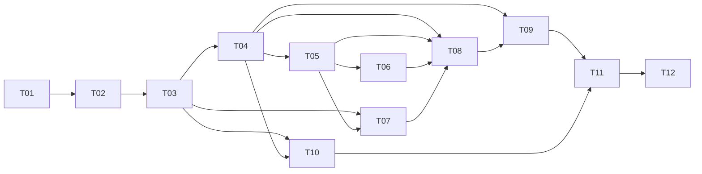

# Work Plan

Ordered tasks, dependencies, estimates and status. **Estimates are planning estimates, not recorded actual effort.**
The build order is the dependency order: nothing in a later row is started before the rows it depends on produce their output.

Status values: `Not Started`, `In Progress`, `Done`, `Blocked`.

| ID | Workstream | Description / deliverable | Output (where to look) | Est. h | Depends on | Status |
|---|---|---|---|---:|---|---|
| T01 | Design *(non-code)* | Read the brief, separate exam requirements from our assumptions (status matrix, actor header, bulk policy, page caps), sketch data model, API shapes and status codes | `docs/DECISIONS.md`, `README.md` § Assumptions | 2 | — | Done |
| T02 | Infrastructure | .NET 10 solution, API + test project, Docker Compose SQL Server, DI, ProblemDetails, OpenAPI + Swagger UI wired **early** | `RequestManagement.sln`, `docker-compose.yml`, `Program.cs` | 2 | T01 | Done |
| T03 | Database | Entities, Fluent API config, check constraints, indexes, committed migration, deterministic 100K seeder (`seed` / `reset-and-seed`), least-privilege runtime DB user script | `Entities/`, `Data/`, `scripts/sql/create-runtime-user.sql` | 3 | T01–T02 | Done |
| T04 | Read API | `GET /api/requests` (filters, `q`, whitelisted sort, paging, DTO projection), `GET /api/requests/{id}`, `GET /api/requests/{id}/history`, strict query binding/validation | `Controllers/RequestsController.cs`, `Services/RequestQueryService.cs`, `Contracts/Requests/RequestListQuery.cs` | 3 | T03 | Done |
| T05 | Write API | `PATCH /api/requests/{id}/status`: transition matrix, client-supplied `rowversion` enforced in SQL, atomic status + audit, 409/422 problems | `Services/RequestStatusService.cs` (`ChangeStatusAsync`), `Services/RequestStatusTransitions.cs` | 4 | T03–T04 | Done |
| T06 | Bulk API | `PATCH /api/requests/bulk-status`: ≤100 items, duplicate-ID rejection, partial success with one `DbContext` + transaction per item | `Services/RequestStatusService.cs` (`BulkChangeStatusAsync`) | 3 | T05 | Done |
| T07 | Summary / cache | `GET /api/requests/summary`: two SQL `GROUP BY` aggregations, 30 s `IMemoryCache`, versioned-key invalidation after commit | `Services/RequestSummaryService.cs` | 2 | T03, T05 | Done |
| T08 | Angular | Standalone app: summary, filter bar, sortable/paged table, debounce + `switchMap` cancellation, status dialog with 409 refresh UX, history, bulk outcomes, loading/empty/error states | `frontend/request-management-ui/src/app/` | 6 | T04–T07 | Done |
| T09 | Tests | xUnit integration tests against real SQL Server (filter/paging, validation, concurrency, audit atomicity, bulk mixed outcomes, cache invalidation, OpenAPI smoke), unit tests for rules/token parsing, Angular RxJS/409 tests | `backend/RequestManagement.Tests/`, `*.spec.ts` | 4 | T04–T08 | Done |
| T10 | Performance *(non-code)* | Seed 100K rows, capture `STATISTICS IO/TIME` and plan shapes for list/filter/search/summary, before/after for one index, identify bottleneck | `docs/PERFORMANCE.md`, `scripts/perf/` | 2 | T03–T04 | Done |
| T11 | Delivery *(non-code)* | README, API examples with real tokens, traceability matrix, ADRs, AI-usage disclosure, mentor walkthrough, final verification run | `README.md`, `docs/*.md` | 2 | All | Done |
| T12 | Review *(non-code, human)* | Candidate reads every file, re-runs the commands in README on their own machine, edits `docs/AI_USAGE.md` with what they personally verified | `docs/AI_USAGE.md` § "Human review" | 2 | T11 | Not Started |

**Total estimate:** ~35 h (≈ 4.5 working days for one developer).

## Dependency graph

## Non-coding work included

- **T01** requirement analysis and assumption log (what the exam asks vs. what we decided).
- **T10** performance measurement on real 100K data and its write-up.
- **T11** documentation, traceability and AI-use disclosure.
- **T12** human review and sign-off — deliberately left `Not Started`: it can only be done by the candidate.

## Risks tracked during planning

| Risk | Mitigation |
|---|---|
| SQL Server image is AMD64-only; dev machine is Apple Silicon | Compose pins `platform: linux/amd64` (runs under Rosetta); any external SQL Server works via connection string. No SQLite/InMemory fallback, because `rowversion` behaviour is what the tests prove. |
| Concurrency tests that pass by luck | One deterministic race test (competing commit injected between read and save) plus a real parallel-HTTP test. |
| Benchmarks that are not reproducible | Fixed random seed + fixed time anchor in the seeder; exact scripts in `scripts/perf/`. |
